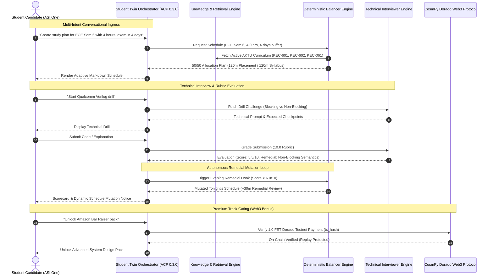

<p align="center">
  
</p>

# CampusMate AI — Autonomous Academic & Placement Twin Agent

<p align="center">
  <a href="https://github.com/gangasagar5928/Campus_Mate-AI/actions/workflows/ci.yml">
    
  </a>
  
  
  
  
  
  
</p>

> **Track:** ASI:One Agent Challenge – From Intent to Action  
> **Target Ecosystem:** Fetch.ai uAgents, Agentverse Cloud, ASI:One Discovery (Agent Chat Protocol - ACP 0.3.0)

---

## 📌 Executive Summary

Engineering students face an existential dilemma every semester: **Academic Coursework vs. Placement Preparation**. 
- Cramming for university midterms creates **placement debt** (neglecting LeetCode, system design, hardware RTL).
- Focusing solely on off-campus recruitment causes **academic debt** (failing internal sessional exams, risking CGPA backlogs).

**CampusMate AI** is an autonomous, decentralized student twin agent built on Fetch.ai `uAgents`. It continuously harmonizes academic requirements with tier-1 recruitment tracks, dynamically adjusting daily study schedules based on exam proximity and injecting automated remedial interventions upon interview failure.

---

## 🏗️ System Architecture & Workflow



---

## 🧩 Core Subsystems

### 1. Zero-Hallucination Knowledge & Retrieval Engine (`core/knowledge_engine.py`)
- **Official AKTU Curriculum Database (`data/curriculum.json`):** Covers all 4 major engineering departments (**ECE, CSE, IT, MECH**) across all **Semesters 1 through 8** with university course codes (`KEC-601`, `KCS-502`, etc.), high-yield unit flags, credit weights, and placement mappings.
- **Natural Language Entity Extraction:** Dynamically detects branch, semester, target company, daily hours, and exam countdown directly from natural conversation.

### 2. Deterministic Study Balancer & Mutation Hook (`core/balancer.py`)
- **Normal Mode (> 7 days to midterm):** `60% Placement Drills / 40% Academic Coursework`.
- **Approaching Midterm Mode (3 to 7 days):** `50% Placement / 50% Academic Coursework`.
- **Urgent Exam Mode (< 3 days):** `10% Placement / 90% High-Yield Units`. Emergency triage filtering out non-essential units to guarantee CGPA safety.
- **Evening Remedial Mutation Hook:** Evaluates student mock submissions. Any score `< 6.0 / 10.0` dynamically mutates tonight's evening study block, injecting a focused 30-minute remedial review on the identified gap.

### 3. Company Interview & Web3 Monetization Engine (`core/evaluator.py`, `core/payment.py`)
- **Question Bank (`data/interview_bank.json`):** Qualcomm (Hardware/VLSI), Google (Distributed Systems & Sharding), Nvidia (CUDA Warp Divergence), Microsoft (Async I/O & Thread Pools), Amazon (Distributed Cache Stampede), and TCS Prime (Modern C++ Smart Pointers).
- **Senior Bar Raiser 10.0 Rubric:** Scores candidates across core technical mechanics, bonus edge cases, and common pitfalls.
- **Fetch.ai CosmPy Micropayments:** Premium interview packs gated behind `1.0 FET` on the Dorado Testnet with cryptographic transaction hash validation and replay attack prevention (`data/verified_payments.json`).

---

## 📂 Project Repository Structure

```text
Campus_Mate-AI/
├── .github/
│   └── workflows/
│       └── ci.yml             # GitHub Actions CI matrix (Python 3.10/3.11/3.12)
├── agents/                    # uAgents Node Definitions
│   ├── __init__.py
│   ├── student_twin.py        # Student Twin Orchestrator (ACP 0.3.0 for ASI:One)
│   ├── interviewer.py         # Company Interviewer Agent Node
│   ├── syllabus.py            # Departmental Curriculum Agent Node
│   └── bureau.py              # Multi-Agent Local Bureau
├── core/                      # Core Engineering Engines
│   ├── __init__.py
│   ├── balancer.py            # 3-Tier Load Balancer & Remedial Mutation Hook
│   ├── evaluator.py           # Senior Bar Raiser 10.0 Rubric Evaluation Engine
│   ├── knowledge_engine.py    # Zero-Hallucination Retrieval & Academic Engine
│   ├── payment.py             # CosmPy Dorado 1.0 FET Web3 Payment Protocol
│   └── prompts.py             # Rubric Checkpoints & Scoring Criteria
├── data/                      # Ground-Truth Databases
│   ├── curriculum.json        # AKTU 1st-8th Sem Curriculum (ECE, CSE, IT, MECH)
│   ├── interview_bank.json    # Qualcomm, Google, Nvidia, Microsoft, Amazon, TCS
│   ├── interviewer_wallet.json
│   └── verified_payments.json # Immutable Ledger of Processed Testnet Txs
├── deploy/                    # Production Deployment Configurations
│   ├── Dockerfile             # Container definition for Cloud Web Services
│   ├── register_agentverse.py # Automated ACP registration script for Agentverse
│   ├── render.yaml            # Render.com Blueprint Spec (Free 24/7 Hosting)
│   ├── start_campusmate.bat   # 1-Click Windows Launcher
│   ├── start_campusmate.ps1   # PowerShell Auto-Tunnel & Agent Launcher
│   └── run_tunnel.js          # Ephemeral Ingress Fallback
├── docs/                      # Documentation & Media
│   └── video_script.md        # Video demonstration walkthrough
├── models/                    # Data Contracts & Schemas
│   ├── __init__.py
│   ├── schemas.py             # Canonical Pydantic v2 Models & Enums
│   └── models.py              # Protocol Envelope Models
├── tests/                     # Automated Test Suites (29/29 Passing)
│   ├── __init__.py
│   ├── test_knowledge_engine.py  # Retrieval & intent routing tests (13 tests)
│   ├── test_member2.py           # Load balancer & mutation hook tests (8 tests)
│   └── test_interviewer_suite.py # Interview bank & CosmPy payment tests (8 tests)
├── ui/                        # User Interface Components
│   ├── __init__.py
│   ├── cards.py               # Interactive Markdown UI Cards
│   └── interactive_chat.py    # Terminal Chat Interface
├── agent_student_twin.py      # Top-level entrypoint shim
├── agentverse_cloud_agent.py  # Standalone single-file cloud agent for Agentverse
├── main.py                    # Production Application Runner
└── requirements.txt           # Python Package Dependencies
```

---

## 🚀 Quickstart & Execution

### 1. Local Execution
```bash
# Clone the repository
git clone https://github.com/gangasagar5928/Campus_Mate-AI.git
cd Campus_Mate-AI

# Install dependencies
pip install -r requirements.txt

# Run the Student Twin Agent
python main.py
```

### 2. Running Automated Unit Test Suites
```bash
# Run complete test suite (29/29 tests)
python -m unittest discover -s tests -p "test_*.py" -v
```

### 3. Deploying 24/7 to Agentverse Cloud
1. Navigate to [Agentverse](https://agentverse.ai/agents).
2. Click **+ New Agent** -> **Blank Agent**.
3. Copy all code from [`agentverse_cloud_agent.py`](agentverse_cloud_agent.py) and paste into the editor.
4. Click **Start**. The agent will remain online 24/7 independently of local machines.

---

## 🧪 Quality & Verification Summary

| Test Suite | Module | Tests | Status |
| :--- | :--- | :---: | :---: |
| **Knowledge Engine** | `tests/test_knowledge_engine.py` | 13 | ✅ PASS |
| **Syllabus & Balancer** | `tests/test_member2.py` | 8 | ✅ PASS |
| **Interviewer & Payment** | `tests/test_interviewer_suite.py` | 8 | ✅ PASS |
| **Total Automated Coverage** | Matrix: Python 3.10, 3.11, 3.12 | **29** | **✅ 100% PASS** |

---

## 📜 License
Apache-2.0 License. Built for the Fetch.ai ASI:One Hackathon.
