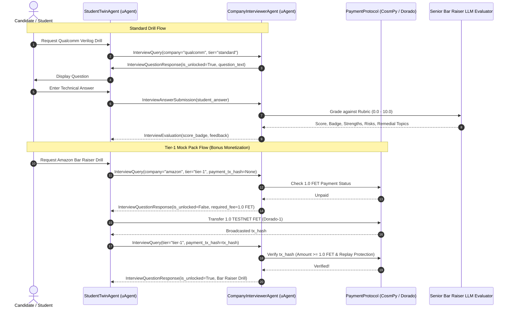

<p align="center">
  
</p>

# CampusMate AI — Autonomous Academic & Career Agent System

<p align="center">
  <a href="https://github.com/gangasagar5928/Campus_Mate-AI/actions/workflows/ci.yml">
    
  </a>
  
  
  
  
  
</p>

> **Track:** ASI:One Agent Challenge – From Intent to Action  
> **Team:** Code Innovex  
> **Target Platforms:** Fetch.ai uAgents, Agentverse, ASI:One (Agent Chat Protocol - ACP)

---
## Interviewer Agent, Payment Protocol & Video Lead

> **Primary Objective:** Own the company-tailored interview drill engine, LLM grading rubric, Payment Protocol bonus, and final submission packaging.

---

## 🏗️ Architecture Overview



---

## 📦 Deliverables & File Structure

| File | Purpose |
|---|---|
| [`interview_bank.json`](interview_bank.json) | Curated company question bank with recruitment tracks (Qualcomm, Google, Nvidia, Microsoft, Amazon, TCS Prime). |
| [`prompts.py`](prompts.py) | Structured LLM evaluation prompts, score badge definitions, and grading rubrics out of 10.0. |
| [`llm_evaluator.py`](llm_evaluator.py) | Evaluation engine supporting Gemini/OpenAI/OmniRoute with a deterministic semantic rubric fallback. |
| [`payment_protocol.py`](payment_protocol.py) | Fetch.ai testnet FET payment verification (CosmPy, Dorado network, replay attack defense). |
| [`models.py`](models.py) | Fetch.ai uAgents Model schemas (`InterviewQuery`, `InterviewEvaluation`, etc.). |
| [`agent_interviewer.py`](agent_interviewer.py) | Company Interviewer Agent (uAgent) serving questions and returning evaluations. |
| [`agent_student_twin.py`](agent_student_twin.py) | Companion Student Twin Agent (uAgent) demonstrating the automated interview drill flow. |
| [`demo_multiagent_bureau.py`](demo_multiagent_bureau.py) | 1-click Fetch.ai Bureau running both agents concurrently in an event loop. |
| [`interactive_chat.py`](interactive_chat.py) | Interactive CLI and modern Tailwind Web dashboard for live candidate drills. |
| [`test_interviewer_suite.py`](test_interviewer_suite.py) | Comprehensive test suite covering all 4 core technical pillars (8/8 passing). |
| [`video_script.md`](video_script.md) | Video Lead hackathon demonstration script and recording storyboard. |
| [`requirements.txt`](requirements.txt) | Python dependencies. |

---

## 🎯 Core Technical Features

### 1. Recruitment Question Bank (`interview_bank.json`)
Covers deep recruitment tracks with official rubrics (`must_include`, `bonus_points`, `common_pitfalls`, `ideal_sample_answer`):
- **Qualcomm Track:**
  - Standard: *Verilog Blocking (`=`) vs. Non-Blocking (`<=`) Assignments*, event scheduling queues, delta cycles, and latch synthesis avoidance.
  - Standard: *Setup ($T_{setup}$) & Hold Time ($T_{hold}$) Violations*, clock skew margin inequalities, and why hold violations cannot be fixed by lowering clock frequency.
  - Tier-1 Advanced Pack: *Clock Domain Crossing (CDC) Asynchronous FIFOs*, Gray-coded pointers, and UPF multi-voltage power gating with level shifters and isolation cells.
- **Google Track:**
  - Standard: *Consistent Hashing, Virtual Nodes (vnodes) & Distributed Key-Value Ring Sharding*.
  - Tier-1 Pack: *Dynamic Programming on Trees & Tree Diameter Optimization*.
- **Nvidia Track:**
  - Standard: *GPU SIMT Execution, Warp Divergence, Shared Memory Bank Conflicts & Coalesced Memory Access*.
- **Microsoft Track:**
  - Standard: *OS Thread Stack Memory, Kernel Context Switching & Non-Blocking Async/Await (IOCP/epoll)*.
- **TCS Prime Track:**
  - Standard: *C++ Pointers, References, Memory Leaks & RAII*, smart pointers (`std::unique_ptr`, `std::shared_ptr`, `std::weak_ptr`), and cyclic reference resolution.
  - Standard: *Virtual Functions, `vtable`/`vptr` Mechanics & Object Slicing*.
  - Tier-1 Advanced Pack: *Lock-Free SPSC Ring Buffer*, acquire-release atomic memory orderings, and cache-line false sharing mitigation via `alignas(hardware_destructive_interference_size)`.
- **Amazon Track:**
  - Standard: *Binary Search Tree (BST) Validation & Lowest Common Ancestor (LCA)* in $O(h)$ time and $O(1)$ space.
  - Standard: *Logistics Routing: Dijkstra vs. DAG Shortest Path Topological Sort* in $O(V + E)$ vs $O((V+E)\log V)$.
  - Tier-1 Bar Raiser Drill: *High-Scale Distributed Cache with LRU Eviction & Write-Back*, Cache Stampede mitigation (XFetch & distributed lease locks), combined with Amazon Leadership Principles (Customer Obsession, Dive Deep, Two-Way Doors).

### 2. Structured LLM Grading Rubric (`prompts.py` & `llm_evaluator.py`)
- Grades student answers out of **10.0** with strict breakdown:
  - Technical Correctness: `/ 4.0`
  - Depth & System Mechanics: `/ 3.0`
  - Synthesis Risks & Edge Cases: `/ 2.0`
  - Clarity & Precision: `/ 1.0`
- Generates competitive score badges:
  - `🏆 Outstanding - Interviewer Strong Hire (9.0 - 10.0)`
  - `✅ Strong Pass - Recommended for Next Round (7.5 - 8.9)`
  - `⚠️ Borderline - Potential with Specific Deficits (6.0 - 7.4)`
  - `❌ Remediation Needed - Below Technical Bar (< 6.0)`
- Returns itemized **Strengths**, **Synthesis Risks** (dangerous misconceptions or missing edge cases), and a **Remedial Topics Roadmap**.

### 3. Payment Protocol & Bonus Monetization (`payment_protocol.py`)
- Satisfies hackathon monetization bonus requirements on Fetch.ai Dorado testnet (`dorado-1`).
- Enforces **1.0 TESTNET FET** transfer check before unlocking Tier-1 Mock Packs (Qualcomm VLSI Advanced Pack & Amazon Bar Raiser Drill).
- CosmPy wallet integration generating genuine `fetch1...` bech32 addresses.
- **Cryptographic Replay Attack Prevention:** Persists claimed `tx_hash` records to prevent double spending.
- Offline/Sandbox voucher simulator for automated testing and demo environments.

---

## 🚀 Quickstart & Usage

### 1. Environment Setup
```powershell
# Activate Python 3.10 virtual environment
.\venv\Scripts\Activate.ps1

# Install requirements
pip install -r requirements.txt
```

### 2. Run the Full Test Suite
```powershell
python -m unittest discover -s . -p "test_*.py" -v
```
*Output: 16/16 unit and integration tests passing!*

### 3. Launch 1-Click Multi-Agent Bureau Demo
```powershell
python demo_multiagent_bureau.py
```
*Spins up `CompanyInterviewerAgent`, `DepartmentalSyllabusAgent`, and `StudentTwinAgent` in an asynchronous Bureau event loop.*

---

## 🏛️ Member 2: Departmental Syllabus Engine & Deterministic Balancing Lead

### Deliverables Owned
- `schemas.py`: Canonical shared data contracts across all three agents.
- `curriculum.json`: Structured AKTU/GCET 1st through 8th-semester branch curriculum database (ECE, CSE, IT, MECH).
- `load_balancer.py`: Deterministic dynamic balancing engine with Evening Remedial Mutation Hook.
- `agent_syllabus.py`: Background Fetch.ai `uAgent` worker node on port 8002.
- `test_member2.py`: Automated unit test suite verifying deterministic formulas, high-yield filters, and mutation hooks.

### Dynamic Allocation Formula
$$\text{Study Allocation} = \begin{cases} 
60\%\text{ Placement } / 40\%\text{ Syllabus}, & > 7\text{ days to exam (Normal)} \\
50\%\text{ Placement } / 50\%\text{ Syllabus}, & 3 \le \text{days} \le 7\text{ (Approaching)} \\
10\%\text{ Placement } / 90\%\text{ High-Yield Syllabus}, & < 3\text{ days (Urgent)}
\end{cases}$$

### Evening Remedial Mutation Hook
When an evaluation reports `score < 6.0 / 10.0`, the mutation hook deterministically injects a **30-minute remedial session** into the candidate's **Evening Block** (`TimeBlock.EVENING`).
